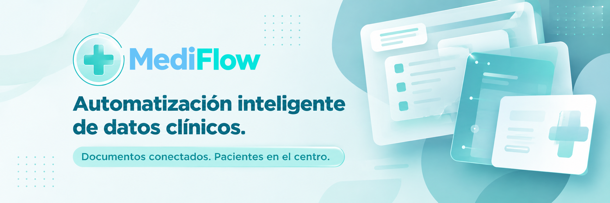
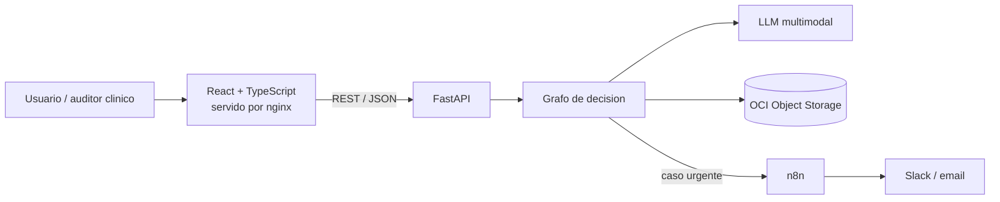
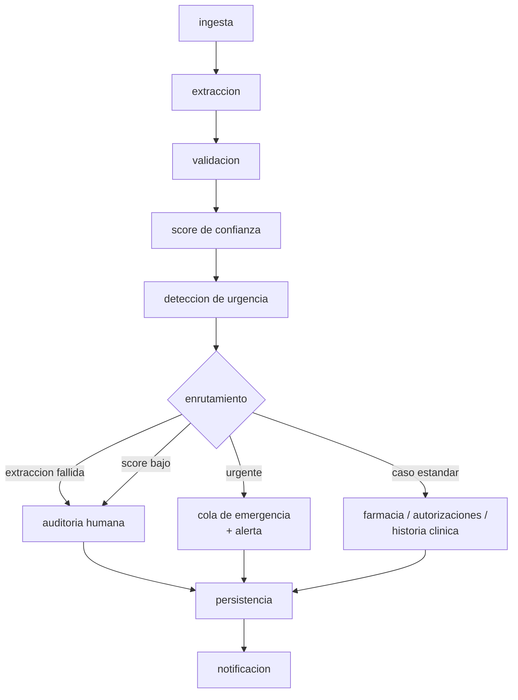

# 🏥 MediFlow-G10-LATAM-Equipo-08


**Sistema inteligente para la clasificación, extracción y gestión de documentos clínicos.** <br>
Proyecto académico desarrollado en el marco del programa ONE G10, Hackathon Oracle Next Education y Alura. <br>
<br>
> [!CAUTION]
> **MediFlow no es un dispositivo médico ni una herramienta de diagnóstico clínico.**
> Es un prototipo académico para el procesamiento documental. Sus resultados no sustituyen la evaluación de profesionales de la salud.
<br>

## Índice

- [Objetivo del proyecto](#objetivo-del-proyecto)
- [Qué propone MediFlow](#qué-propone-mediflow)
- [Arquitectura del sistema](#arquitectura-del-sistema)
- [Flujo de decisión](#flujo-de-decisión)
- [Stack tecnológico](#stack-tecnológico)
- [Cómo ejecutar el proyecto](#cómo-ejecutar-el-proyecto)
- [Estructura del repositorio](#estructura-del-repositorio)
- [Equipo](#equipo)
- [Documentación](#documentación)

---

## Objetivo del proyecto

La gestión de documentos clínicos puede requerir una cantidad considerable de trabajo manual para identificar información, transcribir datos y derivar documentos a los procesos correspondientes.

MediFlow propone automatizar parte de ese flujo mediante inteligencia artificial, validaciones programáticas y reglas explícitas de decisión.

El sistema busca recibir documentos clínicos, identificar su categoría, extraer información relevante, detectar inconsistencias y señales de alarma, y facilitar su derivación al destino correspondiente. Los casos ambiguos o que no cumplan los criterios de validación deben quedar disponibles para revisión humana.

### Principio de diseño

El modelo propone; el sistema valida y aplica reglas explícitas.

El modelo de lenguaje puede proponer una clasificación y extraer información estructurada. La aplicación debe validar los resultados mediante reglas verificables, calcular indicadores de confianza de la extracción y aplicar criterios de derivación definidos en el sistema.

La confianza de una extracción no equivale a la certeza de un diagnóstico ni garantiza que la información clínica sea correcta.


## Qué propone MediFlow

El flujo funcional previsto contempla las siguientes etapas:

1. **Ingesta documental:** recibir documentos en los formatos admitidos por la implementación.
2. **Clasificación:** identificar la categoría documental, como recetas, informes de estudios, órdenes de procedimientos, epicrisis o certificados médicos.
3. **Extracción:** estructurar información clínica y administrativa presente en el documento.
4. **Validación:** comprobar la consistencia de los datos extraídos y, cuando corresponda, contrastarlos con fragmentos del documento original.
5. **Evaluación de confianza:** calcular un indicador basado en criterios explícitos de validación.
6. **Identificación de señales de alarma:** aplicar criterios de revisión previamente definidos, sin sustituir la evaluación clínica profesional.
7. **Derivación:** proponer el destino documental correspondiente o enviar el caso a revisión humana.
8. **Persistencia y seguimiento:** registrar el documento y el resultado del procesamiento mediante los mecanismos de almacenamiento implementados.

Los formatos admitidos, las categorías documentales, los destinos disponibles y las capacidades efectivamente operativas dependen de la versión implementada.

## Arquitectura del sistema

La arquitectura objetivo contempla una interfaz web, una API para el procesamiento documental, un grafo de decisión, servicios de inteligencia artificial y componentes de almacenamiento y notificación.


El diagrama representa la arquitectura conceptual prevista. Las conexiones y los servicios deben contrastarse con la implementación disponible antes de considerarlos operativos.

### Componentes previstos

| Capa | Tecnología o componente | Función |
|---|---|---|
| Interfaz | React, TypeScript y Vite | Interacción con el usuario |
| API | FastAPI y Pydantic v2 | Recepción y validación de solicitudes |
| Orquestación | LangGraph | Organización del flujo de decisión |
| IA | Google Gemini | Clasificación y extracción asistida |
| Base de datos | PostgreSQL | Persistencia estructurada prevista |
| Almacenamiento | OCI Object Storage | Almacenamiento documental previsto |
| Automatización | n8n | Orquestación de notificaciones |
| Infraestructura | Docker Compose y OCI Compute | Ejecución y despliegue previstos |

## Flujo de decisión

El siguiente diagrama describe el comportamiento lógico que se busca implementar.



### Trazabilidad y supervisión

Cuando la implementación lo permita, los datos extraídos deben conservar referencias verificables al documento de origen. Las validaciones deben comprobar que las referencias correspondan al contenido recibido.

La identificación de una señal de alarma debe tratarse como un mecanismo de apoyo a la revisión, no como una confirmación de emergencia clínica. Las reglas de derivación, los criterios de confianza y las acciones de seguimiento deben poder auditarse.

Los casos no resueltos por las validaciones automáticas deben quedar sujetos al procedimiento de revisión definido por el equipo.

## Stack tecnológico

Las siguientes tecnologías forman parte del stack previsto para el proyecto. Su inclusión no implica que todas estén integradas en la versión actual.

### Inteligencia artificial y backend


- **IA:** Google Gemini, para tareas de lenguaje y procesamiento multimodal previstas.
- **Backend:** Python 3.12, FastAPI y Pydantic v2.
- **Orquestación:** LangGraph para organizar los nodos y las decisiones del flujo.
- **Diseño de software:** separación de responsabilidades entre dominio, aplicación y adaptadores, conforme a la arquitectura definida por el equipo.

### Frontend


- React 19.
- TypeScript.
- Vite.
- Tailwind CSS y shadcn/ui.

### Datos, nube e infraestructura


- PostgreSQL 16.
- Oracle Cloud Infrastructure (OCI): Object Storage y Compute.
- Docker Compose para la orquestación de servicios.
- n8n para automatizaciones y notificaciones.
- Servidor web y proxy inverso, cuya configuración definitiva debe coincidir con los archivos de infraestructura del repositorio.

## Cómo ejecutar el proyecto

### Primera etapa del backend

Para ejecutar la versión actual, consulta las instrucciones específicas del backend:

- [README del backend](backend/README.md)
- [Contrato y secuencia de implementación](docs/BACKEND_PRIMERA_ETAPA.md)

La documentación de esta etapa contempla endpoints con IA simulada, documentos locales e historial en memoria. Consulta los archivos anteriores para conocer los requisitos y comandos efectivos.

### Variables de entorno

Si el backend requiere una clave de API de Gemini, utiliza el archivo de ejemplo que proporcione el repositorio:

```bash
cp backend/.env.example backend/.env
```

Completa las variables necesarias según las instrucciones del backend. No publiques claves de API, credenciales ni archivos `.env` con secretos en Git.

### Ejecución con Docker Compose

El siguiente procedimiento es aplicable únicamente cuando el archivo Compose y los servicios correspondientes estén disponibles y configurados:

```bash
docker compose up --build
```

Antes de ejecutar el entorno completo, verifica la existencia de `compose.yaml` o `docker-compose.yml`, los Dockerfiles y las variables de entorno requeridas.

No se incluye aquí un comando de clonación porque la URL canónica del repositorio debe confirmarse con el equipo.

## Versionado y reproducibilidad

Para facilitar la colaboración entre integrantes y evitar diferencias entre entornos, el proyecto debe mantener versiones coherentes y dependencias reproducibles.

| Componente | Convención prevista |
|---|---|
| Python | 3.12, definido en `.python-version` |
| Dependencias Python | Versiones reproducibles mediante un archivo de bloqueo |
| Node.js | Línea LTS acordada por el equipo |
| Dependencias Node.js | `package-lock.json` versionado |
| Instalación Node.js en CI | `npm ci` cuando exista un `package-lock.json` compatible |
| Infraestructura | Configuración versionada y alineada con los servicios reales |

Los archivos de bloqueo deben generarse y mantenerse conforme a la herramienta de gestión de dependencias que adopte el equipo. La configuración documentada debe coincidir con la utilizada para ejecutar y probar el proyecto.

## Estructura del repositorio

La siguiente estructura es orientativa y debe mantenerse sincronizada con el árbol real del repositorio.

```text
.
├── backend/     # API, lógica de aplicación, adaptadores y pruebas
├── frontend/    # Interfaz web con React, TypeScript y Vite
├── n8n/         # Flujos de automatización exportados
├── data/        # Datos sintéticos y herramientas de generación
├── infra/       # Configuración de infraestructura y despliegue
└── docs/        # Documentación, decisiones y planificación
```

## Equipo

El equipo organiza el trabajo en torno a las áreas de resultados esperados del programa: IA y agentes, backend y automatización, infraestructura OCI y documentación.

Consulta el [plan del equipo](docs/plan-equipo.md) para conocer los roles, responsables, cronograma y decisiones de implementación.

## Documentación del proyecto

| Documento | Contenido |
|---|---|
| [`backend/README.md`](backend/README.md) | Instrucciones de ejecución del backend |
| [`docs/mediflow-agente-autonomo.md`](docs/mediflow-agente-autonomo.md) | Instructivo oficial del hackathon (Alura/Oracle) |
| [`docs/plan-equipo.md`](docs/plan-equipo.md) | Plan de roles, cronograma y decisiones a validar en el kickoff |

---

## Alcance y uso responsable

MediFlow es un prototipo académico. No debe utilizarse para tomar decisiones clínicas reales, diagnosticar enfermedades, prescribir tratamientos ni determinar por sí solo la necesidad de atención de emergencia.

Los datos utilizados durante las pruebas deben ser sintéticos o estar debidamente anonimizados. Cualquier futura utilización con información clínica real requerirá revisar las medidas de seguridad, privacidad, control de acceso, trazabilidad y supervisión humana aplicables.

Las funcionalidades descritas como parte de la arquitectura objetivo deben verificarse contra el código y las pruebas antes de considerarse implementadas.
