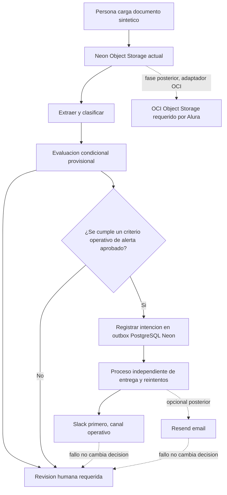

# Plan de MVP para alertas externas y evolución por fases

**Decisión recomendada:** priorizar Slack mediante un webhook entrante como primer canal externo, respaldado por una bandeja de salida persistente en PostgreSQL/Neon. El correo con Resend queda como ampliación opcional. Las alertas serán señales operativas sintéticas: nunca contendrán datos de pacientes ni tomarán decisiones clínicas o de enrutamiento.

Este documento propone una secuencia de trabajo; no acredita que esas capacidades estén implementadas. La integración de OCI Object Storage sigue siendo un requisito de Alura pendiente antes de afirmar que el checklist de la fuente está completo.

## Estado frente al reto de Alura

| Requisito o diferenciador | Estado actual conocido | Acción propuesta |
|---|---|---|
| Ingesta de PDF, imagen y texto | El flujo actual acepta documentos para procesamiento. | Estabilizar el recorrido y mantener casos de demostración con documentos sintéticos. |
| Grafo condicional, clasificación, confianza y decisión | Fase 1 añade ramas condicionales para rutina, ambigüedad/incompletitud y urgencia. Las ramas solo agregan una traza efímera; el resultado actual lo determina `decide`. No hay score ni corte de confianza. | Las pruebas focalizadas pasan. Acordar por separado cualquier regla clínica o umbral antes de activarlo. |
| Revisión humana ante resultados que requieren evaluación | Los resultados de IA requieren revisión humana; no hay despacho externo implementado. | Preservar revisión como autoridad decisoria y comprobar sus transiciones en la fase de estabilización. |
| OCI Object Storage obligatorio | El almacenamiento de archivos actual usa Neon Object Storage; no satisface por sí mismo el requisito de OCI indicado por Alura. | Planificar un adaptador de almacenamiento OCI y verificarlo antes de declarar completo el requisito. |
| Alertas externas Slack/email opcionales | No hay envío externo implementado. | Añadir primero Slack como señal operativa; considerar Resend después, de forma independiente. |
| Jev/TypeSafe y Doctoc/STT posteriores | No forman parte del MVP de alertas. | Evaluarlos en una etapa posterior, sin permitir que enruten casos clínicos automáticamente. |

## Flujo propuesto

El procesamiento y la revisión humana son el flujo principal. La intención de notificación se registra de forma persistente, y el envío/reintento ocurre como trabajo independiente: un fallo del proveedor no debe hacer fallar la ingesta, bloquear la revisión ni cambiar el enrutamiento.

La alerta mínima debería incluir solamente un identificador sintético de documento, un código de motivo no clínico, la hora y una ruta interna de la aplicación. No debe incluir contenido del documento, nombres, diagnósticos, identificadores reales ni datos personales o de salud. La alerta no es autorización, diagnóstico, decisión clínica ni despacho.

## Secuencia por fases

| Fase | Alcance | Criterio para avanzar |
|---|---|---|
| 1. Estabilizar el núcleo de Alura | Consolidar ingesta, extracción/clasificación, decisiones condicionales y revisión humana; separar claramente simulación de capacidad real. | Los casos de demostración sintéticos recorren el flujo esperado y los pendientes/propuestas clínicas quedan identificados como no aprobados. |
| 2. Outbox confiable | Añadir una tabla aditiva `notification_events` o outbox en PostgreSQL/Neon, con intención, canal, estado, fechas, contador de reintentos, clave de idempotencia y referencia sanitizada del proveedor/error. No almacenar contenido sensible del mensaje. | Un fallo o reinicio no elimina la intención; duplicados se deduplican y los fallos no alteran ingesta, revisión humana ni enrutamiento. |
| 3. Slack primero | Enviar desde el outbox a un canal de demostración mediante Slack Incoming Webhook. Mantener la URL del webhook como secreto fuera del repositorio y de los registros. | Una alerta sintética llega al canal configurado; el fallo queda trazado de forma sanitizada y no cambia el flujo clínico. |
| 4. Resend opcional | Evaluar correo como segundo canal con configuración independiente, API key y remitente/dominio verificados según el proveedor. | Caso de uso y destinatarios operativos definidos; envío de prueba sintético aislado y protección de secretos comprobada. |
| 5. Login y autorización | Tratar autenticación/autorización como trabajo separado: usuarios e identificadores de sujeto, actor de revisión relacionado con usuario, roles, endpoints protegidos y autorización de acceso/descarga. | Se define quién puede revisar y acceder a documentos; no se asume un proveedor de autenticación en este plan. |
| 6. OCI Object Storage | Incorporar OCI mediante un adaptador de almacenamiento, conservando el puerto y el flujo de aplicación para reducir acoplamiento al proveedor actual. | Integración verificada con datos sintéticos y evidencia suficiente para marcar satisfecho el requisito obligatorio de Alura. |
| 7. Jev/TypeSafe y Doctoc/STT | Valorar estas capacidades como iniciativas posteriores y separadas del MVP de alertas. | Requisitos y límites aprobados; ninguna automatización enruta casos clínicos sin una decisión humana autorizada. |

Las fases son una secuencia de planificación, no evidencia de trabajo realizado. OCI puede evolucionar en paralelo si se acuerda su prioridad, pero el requisito no debe marcarse como satisfecho hasta que exista integración verificable.

### Fase 1: estado del flujo condicional

El grafo enruta rutina, ambigüedad/incompletitud y urgencia a nodos terminales que solo
añaden una traza efímera; no guardan estado ni realizan una revisión. La decisión que ve
el flujo actual proviene del dominio: rutina queda como `PROCESSED` con destino propuesto
`HISTORIA_CLINICA`, sin aprobación ni despacho; señales de auditoría, campos requeridos
ausentes y urgencia quedan en `NEEDS_AUDIT`/`REVISION_HUMANA`. La urgencia conserva
`urgent_alert`; solo una aprobación humana explícita puede autorizar `EMERGENCIA_MEDICA`.
La confianza se conserva como dato informado, sin corte ni calibración.

La verificación focalizada se ejecutó con los ejecutables existentes de `backend/.venv`
porque `uv` no está disponible: 23 pruebas focalizadas pasaron, Ruff check pasó, Ruff
format check pasó (con una advertencia de caché y código de salida 0) y `git diff --check`
pasó con advertencias de normalización LF/CRLF. El coordinador repitió la comprobación
focalizada y obtuvo 23 aprobadas. La evaluación nativa de riesgo fue alta/no evaluable
porque los archivos sin seguimiento no estaban declarados; una revisión estática
independiente no encontró bloqueos. No se ejecutó la suite completa ni se afirma
validación clínica, persistencia durable del grafo o despacho real. OCI Object Storage
continúa pendiente como requisito obligatorio de Alura.

### Fase 2: estado local del outbox

El adaptador SQLAlchemy crea un único evento `REVIEW_REQUIRED` en `PENDING` para un
resultado de dominio `NEEDS_AUDIT`, con canal previsto `SLACK`. La clave idempotente es
un SHA-256 de documento y tipo; el registro guarda solo ese hash y una referencia a la
fila interna del triaje, sin copiar el identificador público ni datos clínicos. La
inserción comparte la transacción que finaliza el triaje. El esquema ORM y sus pruebas
usan SQLite; la revisión en memoria no tiene outbox persistente.

La prueba focalizada de persistencia (35 aprobadas), Ruff check/format check y
`git diff --check` pasaron con el entorno existente. El intento de suite completa se
interrumpió sin salida ni resumen, por lo que queda sin resultado. La migración aditiva
`0004` está escrita pero no fue ejecutada contra PostgreSQL ni Neon. No hay worker,
reintento efectivo, envío, validación clínica ni despacho real.

## Slack frente a correo

| Canal | Recomendación | Consideraciones |
|---|---|---|
| Slack Incoming Webhook | Primer canal para el MVP: unidireccional y acotado a un canal de demostración. | La URL del webhook es un secreto. La disponibilidad del nivel gratuito depende de límites vigentes, políticas del espacio de trabajo y administración. No usarlo como canal clínico ni como despacho. |
| Resend | Canal opcional posterior, no requisito del primer MVP. | Los precios y límites publicados pueden cambiar. La configuración requiere API key y remitente/dominio según el modo de envío. Confirmar condiciones vigentes al implementarlo. |

Referencias del proveedor: [Slack Incoming Webhooks](https://api.slack.com/messaging/webhooks), [precios de Slack](https://slack.com/pricing/free), [precios de Resend](https://resend.com/pricing), [Resend con FastAPI](https://resend.com/fastapi) y [Resend con Python](https://resend.com/python). Las cifras comerciales no se fijan como requisito porque pueden variar.

## Impacto de datos y acceso

- El outbox agrega trazabilidad de intención y entrega sin convertir la base actual en un almacén del contenido de alertas. Mantener el cuerpo mínimo o reconstruible con datos sintéticos, nunca con PHI.
- La idempotencia, los reintentos acotados y una referencia sanitizada de proveedor ayudan a evitar duplicados y permiten investigar fallos sin registrar secretos ni contenido sensible.
- El actor actual de revisión no equivale a una identidad autenticada. Autenticación, roles, protección de endpoints y autorización de acceso/descarga necesitan diseño y validación propios; este plan no elige proveedor.
- Neon Object Storage actual y OCI Object Storage del requisito son proveedores distintos. La persistencia en Neon no permite declarar completado el requisito explícito de OCI.

## Criterios de aceptación del MVP de alertas

- [ ] Solo se usan documentos y datos sintéticos en desarrollo y demostraciones.
- [ ] El evento de notificación persiste antes de intentar la entrega y puede recuperarse tras un reinicio.
- [ ] La clave de idempotencia evita crear entregas duplicadas para la misma intención.
- [ ] La entrega y sus reintentos se ejecutan de manera independiente al pipeline de ingesta y revisión.
- [ ] Un fallo del proveedor no falla la ingesta, no impide la revisión humana y no cambia la decisión ni el enrutamiento.
- [ ] La alerta contiene únicamente identificador sintético, código de motivo operativo, hora y ruta interna; no incluye nombre, diagnóstico, texto del documento ni otro dato sensible.
- [ ] URL de webhook, API keys y secretos se mantienen fuera del repositorio, documentación operativa y logs.
- [ ] Los estados de entrega y referencias de error quedan sanitizados y auditables.
- [ ] Ninguna alerta constituye autorización humana, decisión clínica o confirmación de despacho.
- [ ] La integración OCI se verifica por separado antes de declarar satisfecho el requisito obligatorio de Alura.

## Fuera de alcance y advertencias

- Este documento no implementa envío, outbox, autenticación, autorización, migraciones ni integración OCI.
- No se aprueban pesos, umbrales, scores ni reglas clínicas; las propuestas existentes requieren decisión humana antes de cualquier activación.
- Una aprobación humana no aumenta artificialmente un score ni demuestra que se realizó un despacho.
- Las pruebas de software y las demostraciones no acreditan seguridad clínica.
- No enviar datos reales de pacientes por Slack, correo u otros canales externos. Mantener las notificaciones como señales operativas mínimas.

## Siguiente paso

Validar la prioridad de las fases con el equipo; después, acordar el contrato del outbox y sus estados antes de implementar el primer canal. Mantener OCI como pendiente explícito del checklist de Alura hasta verificar su adaptador.
